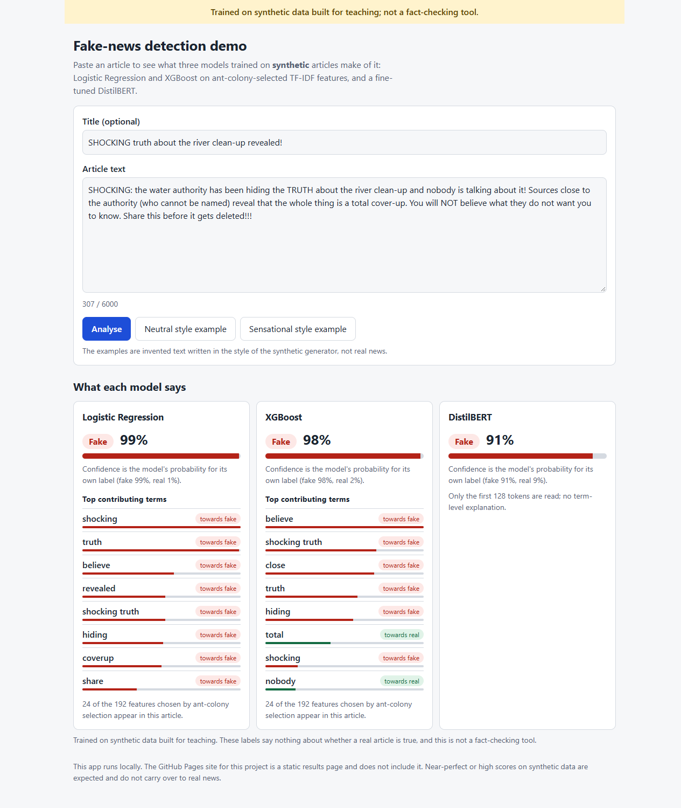
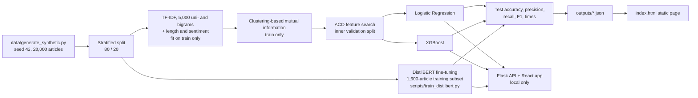

> **Trained on synthetic data built for teaching; not a fact-checking tool.**

# Fake News Detection Teaching Demo: Logistic Regression, XGBoost and DistilBERT with ant-colony feature selection, on synthetic data

[](https://creativecommons.org/licenses/by-nc-nd/4.0/)
[](https://janeferdinant.github.io/news/)

## Overview

A teaching notebook, a static results page and a small local web app that walk through a text-classification pipeline: exploratory analysis, TF-IDF features, feature selection with ant colony optimisation (ACO) guided by clustering-based mutual information, and a comparison of Logistic Regression, XGBoost and a fine-tuned DistilBERT. It was written for an AI course (JNTUK, II Year, Term 1). **All data is synthetic, so the results illustrate the method and say nothing about detecting real fake news.** The page hosted on GitHub Pages is a static results view; the Flask + React app that scores pasted text runs locally.

## Demo

- **Static results page (hosted):** [`index.html`](index.html) is served by GitHub Pages at https://janeferdinant.github.io/news/. It shows a four-step explainer, the features chosen by ACO, a model-comparison table (accuracy, precision, recall, F1, training and inference time), and two charts, all read from the committed files in [`outputs/`](outputs/). It also has eight colour themes. It needs no server: React and Plotly load from a CDN, and the page code is precompiled. It does **not** contain the app below.
- **Flask + React app (local only, not deployed):** paste an article and see each model's label and confidence and, for the classical models, the terms that contributed most. See "Run the local app" below.

To view the static page locally, from the repository root:

```bash
python -m http.server
```

Then open http://localhost:8000.


The local app at 390 px and 1280 px (the example is invented text, not real news): [`docs/app-390.png`](docs/app-390.png) and [`docs/app-1280.png`](docs/app-1280.png).



## Problem statement

Teaching text classification needs a dataset that students can regenerate, inspect and redistribute, with a feature-selection step that is easy to see. Because the data here is synthetic, the project does not claim to solve fake-news detection; it demonstrates the workflow and the evaluation discipline (split first, select features on training data only, report against a baseline).

## Approach



1. **Generate** synthetic articles (see Data).
2. **Split** the articles into train and test sets *before* anything is fitted. The DistilBERT script uses exactly the same split call (`fakenews/data.py`) and checks that no training row is in the test set.
3. **Features:** TF-IDF on the cleaned text (up to 5,000 unigrams and bigrams, fitted on the training articles only) plus three engineered features: text length, title length and TextBlob sentiment.
4. **Mutual information:** each feature's values are clustered into three groups with k-means, and the mutual information between cluster and label scores the feature (training data only).
5. **ACO:** 15 ants over 30 iterations each pick 50 to 200 features, favouring high MI and high pheromone. A subset is scored with Logistic Regression on an inner validation split of the training data. The test set is never used here.
6. **Classical models:** Logistic Regression and XGBoost are fitted on the selected features of the full training split.
7. **DistilBERT:** `distilbert-base-uncased` is fine-tuned on raw title + text (first 128 tokens) using a seeded, stratified **subset of 1,600 training articles** for a fixed 2 epochs, so that it fits a 20-minute CPU budget. A 700-second time guard stops training early if the CPU is slow.
8. **Compare** all three on the same 4,000 held-out test articles, with a majority-class baseline. `scripts/build_comparison.py` writes the files the static page reads.
9. **Explain (app only):** for Logistic Regression the contribution of a selected feature is its coefficient times its value; for XGBoost it is the booster's exact per-feature contribution. Only terms that occur in the pasted article are listed. DistilBERT has no term-level explanation.

## Data

- **The original dataset is missing.** `fake_news_dataset.csv` (described in [`dataset_description.md`](dataset_description.md)) is not in this repository, and the owner does not remember where it came from. **On 2026-10-13 the generator [`data/generate_synthetic.py`](data/generate_synthetic.py) was added to regenerate a dataset** with the same seven columns the notebook expects (`title`, `text`, `date`, `source`, `author`, `category`, `label`). It does not reproduce the original rows.
- **Fully synthetic:** every article is assembled from template sentences about invented events. Outlets and author names are fictional. "Fake" articles differ from "real" ones only by writing style (sensational wording, capitals, exclamation marks, vague sources). The styles overlap by design: about 15% of articles of each label are written in the other label's style.
- **Size and balance:** 20,000 rows by default (10,000 real, 10,000 fake), 8 categories, 200 to 320 words per article, dates in the three years before 2026-10-01, and about 5% missing `source` and `author`.
- **Reproducible:** the output depends only on the seed (default 42). With the defaults the file's SHA-256 is `bd1d81f9236c8ee554d32c2053f5e1f0529cfb5cc7d657deef70eb1a53b4a923`.
- **Not committed:** the CSV is 33 MB and is git-ignored. Generate it with the command below.
- **Split:** stratified 80/20, `random_state=42`: 16,000 train and 4,000 test articles. DistilBERT trains on 1,600 of the 16,000 and watches 400 other training articles; it never sees the test articles.
- **License and privacy:** the generator and its output are original work under CC BY-NC-ND 4.0. There is no personal data.

## Results

Measured on the 4,000 held-out synthetic test articles. Run logs: [`docs/runs/2026-10-14-distilbert.md`](docs/runs/2026-10-14-distilbert.md) (this table) and [`docs/runs/2026-10-13-rerun.md`](docs/runs/2026-10-13-rerun.md) (the earlier run of the same classical models, with identical selected features). Precision, recall and F1 are macro-averaged over the two classes.

| Model | Accuracy | Precision | Recall | F1 | Training time | Inference time (4,000 articles) | Status |
|---|---|---|---|---|---|---|---|
| Logistic Regression | 0.8400 | 0.8403 | 0.8400 | 0.8400 | 0.2 s | 1.8 ms (features precomputed) | Verified (re-run 2026-10-14 on regenerated synthetic data, seed=42, subset=full 16,000-article training split) |
| XGBoost | 0.8385 | 0.8385 | 0.8385 | 0.8385 | 6.8 s | 8.5 ms (features precomputed) | Verified (re-run 2026-10-14 on regenerated synthetic data, seed=42, subset=full 16,000-article training split) |
| DistilBERT | 0.8532 | 0.8533 | 0.8533 | 0.8532 | 726.8 s (stopped by the time guard at step 156 of 200) | 256.6 s (includes tokenisation) | Verified (re-run 2026-10-14 on regenerated synthetic data, seed=42, subset=1,600 of 16,000 training articles, max_len=128, epochs=2) |

| Metric | Value | Status | How measured | Date |
|---|---|---|---|---|
| Majority-class baseline accuracy | 0.5000 | Verified (re-run 2026-10-14 on regenerated synthetic data, seed=42) | share of the larger class in the test set | 2026-10-14 |
| ACO validation accuracy | 0.8234 | Verified (re-run 2026-10-14 on regenerated synthetic data, seed=42, subset=inner 20% of the training split) | Logistic Regression on an inner validation split of the training data | 2026-10-14 |
| Features selected by ACO | 192 of 5,003 | Verified (re-run 2026-10-14 on regenerated synthetic data, seed=42) | ACO on the training split | 2026-10-14 |
| DistilBERT validation accuracy | 0.8725 after epoch 1, 0.8700 at the stop | Verified (re-run 2026-10-14 on regenerated synthetic data, seed=42, subset=400 held-out training articles) | 400 training-split articles not used for fitting | 2026-10-14 |
| Notebook run time | 311 s | Verified (re-run 2026-10-14 on regenerated synthetic data, seed=42) | wall time of `jupyter nbconvert --execute` on a CPU shared with other jobs | 2026-10-14 |

**Read these numbers with care.**

- They come from synthetic articles whose labels are a writing-style recipe, so they say nothing about real-world fake-news detection. High scores on synthetic data are expected, and a near-perfect score would not prove anything. The three models sit near 0.85 here because about 15% of the articles are written in the other label's style on purpose; the top features (`truth`, `coverup`, `shocking`, `caught`, `hiding`) are the generator's own trigger words.
- The models differ by at most 1.5 points on one split and one seed, so there is no basis for ranking them. DistilBERT saw 10% of the training articles and the first 128 tokens of each; with the full data it might score differently.
- The times were measured on a machine shared with other jobs and are not a benchmark. Classical inference times exclude text cleaning and TF-IDF, while the DistilBERT time includes tokenisation, so they are not like for like.
- The earlier "~90% accuracy" claim in this repository had no run behind it and has been removed. Earlier README text listed DistilBERT before it had ever been run; this version has a real, logged run.

## Tech stack

Python 3.11, pandas, NumPy, scikit-learn, XGBoost, NLTK, TextBlob, WordCloud, Matplotlib, Plotly (Python and plotly.js), Jupyter, PyTorch 2.5.1 (CPU build) and Hugging Face Transformers 4.46.3 (DistilBERT), Flask 3.0.3 (API), React 18.3.1 with Vite 5.4.11 and Vitest 2.1.8 (local app), pytest and ruff. The static page uses React 18 (precompiled JSX, no in-browser Babel) and plotly.js 2.27, both loaded from a CDN with integrity hashes.

## Getting started

Prerequisites: Python 3.11 (verified on 3.11.9; the pinned NumPy 1.24.3 does not install on Python 3.12 or later), about 2 GB of free memory (the TF-IDF matrix is dense, about 0.7 GB) and, for the app, Node.js 20 or later (verified on 22). The first run downloads two small NLTK data sets, so it needs internet access.

### 1. Notebook and static page

```bash
git clone https://github.com/Janeferdinant/news.git
cd news
python -m venv .venv
source .venv/bin/activate        # Windows: .venv\Scripts\activate
pip install -r requirements.txt
python data/generate_synthetic.py
jupyter nbconvert --to notebook --execute --ExecutePreprocessor.timeout=1200 --inplace fake_news_detection_enhanced_kaggle.ipynb
python -m http.server
```

Expected output: the generator prints `wrote .../data/fake_news_dataset.csv (20000 rows, 33,114,895 bytes)` and the SHA-256 above. The notebook run takes 2 to 5 minutes (it was 311 s on a busy machine) and rewrites `outputs/` (it prints `Accuracy: 0.84` for Logistic Regression and `Accuracy: 0.8385` for XGBoost into the saved notebook); `mi_scores.json` and `selected_features.txt` come out identical, and `classical_metrics.json`, `model_metrics.json` and `model_comparison.json` are rewritten with new timings. Then open http://localhost:8000. `--inplace` refreshes the outputs stored in the notebook. Interactive use works with `jupyter lab`. The notebook has not been tested on Kaggle or Colab.

### 2. Fine-tune DistilBERT (optional, about 15 to 17 minutes on CPU)

Run this in the same virtual environment, after step 1 (it needs the generated CSV). It installs the CPU build of PyTorch, downloads `distilbert-base-uncased` (about 270 MB) to the Hugging Face cache, and saves the weights to the git-ignored `artifacts/` folder.

```bash
pip install -r requirements-dev.txt --extra-index-url https://download.pytorch.org/whl/cpu
export HF_HOME="$HOME/.cache/huggingface"   # or any folder outside the repository; on Windows set the variable in your shell
python scripts/train_distilbert.py --train-subset 1600 --val-subset 400 --max-len 128 --epochs 2 --batch-size 16 --time-budget 700 --model-dir artifacts/distilbert
python scripts/build_comparison.py
```

Expected output: the split (`16000 train / 4000 test`), step losses every 25 steps, a validation accuracy per epoch, a JSON block of test metrics and `Saved weights to ...`. Training stops by itself after 700 s if the CPU is slow; the stop is recorded in `outputs/distilbert_metrics.json`. Results vary slightly with CPU speed, because the time guard can stop training at a different step. Do not commit the weights.

### 3. Run the local Flask + React app

Needs the pickles from step 1 (`outputs/models/`) and, for DistilBERT, the folder from step 2 (`artifacts/distilbert`). A model whose files are missing is reported as unavailable; the others still work.

```bash
cd app/frontend
npm ci
npm run build
cd ../..
python app/server.py
```

Then open http://127.0.0.1:5000. For front-end development, run `python app/server.py` in one terminal and `npm run dev` in `app/frontend` in another, then open http://localhost:5173 (it proxies `/api` to Flask).

| Setting | Default | Meaning |
|---|---|---|
| `NEWS_CLASSICAL_DIR` | `outputs/models` | folder with the notebook's four pickles |
| `NEWS_DISTILBERT_DIR` | `artifacts/distilbert` | folder written by `train_distilbert.py` |
| `NEWS_MAX_CHARS` | `6000` | longest accepted article text (longer gets HTTP 413) |
| `NEWS_HOST`, `NEWS_PORT` | `127.0.0.1`, `5000` | bind address; keep it on loopback |

API: `GET /api/health`, `GET /api/models`, and `POST /api/predict` with `{"title": "...", "text": "..."}` (the title is optional, the text must be non-empty and within the cap; optional `"models": ["xgboost"]`). It returns, per model, `label`, `confidence`, `probabilities` and `top_terms`.

Tests and lint:

```bash
pytest -q
ruff check .
cd app/frontend && npm test
```

Expected: `34 passed` for pytest, `All checks passed!` for ruff and `7 passed` for Vitest. The pytest API tests use mocked models; two test groups train tiny models on invented sentences (the latter need the NLTK data from step 1).

### Docker (optional, not deployed)

`docker compose up --build` builds the front end and the API into one image (the models are mounted read-only from `outputs/models` and `artifacts/distilbert`, and the port is published on 127.0.0.1 only). `docker compose config` validates the file, but the image has **not** been built or run in this repository's checks (the Docker engine was not running), so treat the virtual-environment route above as the verified one.

### Optional tools

To rebuild the static page's JavaScript after editing `assets/app.jsx`:

```bash
npm install --no-save @babel/standalone@7.22.9
node scripts/build_jsx.mjs
```

To use the older optional JSON server for the notebook outputs (not needed by the page or the app): `python scripts/serve_outputs.py`, which serves `outputs/` at http://127.0.0.1:5000/get_kaggle_outputs. It was `app.py` in earlier versions; it moved because `app/` is now the Flask + React app.

`python scripts/check_app_parity.py --n 400` scores 400 seeded test articles one at a time through the app's code path (it needs the pickles); it is a sanity check that the app's preprocessing matches the notebook, not a new benchmark.

## Project structure

```
README.md                                   this file
fake_news_detection_enhanced_kaggle.ipynb   the notebook (EDA, features, ACO, classical models, outputs)
data/generate_synthetic.py                  seeded generator for the synthetic dataset
dataset_description.md                      description of the dataset's columns
fakenews/                                   shared code: notebook split, single-article features
scripts/train_distilbert.py                 CPU fine-tuning of DistilBERT on the notebook's split
scripts/build_comparison.py                 merges the results into the files the static page reads
scripts/check_app_parity.py                 sanity check of the app's pipeline
scripts/serve_outputs.py                    optional JSON server for outputs/ (was app.py)
scripts/build_jsx.mjs                       compiles the static page's JSX
outputs/                                    mi_scores.json, model_comparison.json, model_metrics.json,
                                            classical_metrics.json, distilbert_metrics.json, selected_features.txt
index.html, assets/                         the static results page (assets/app.jsx is the source of assets/app.js)
app/server.py, app/services.py              Flask API and model services (local)
app/tests/                                  pytest tests (mocked models; tiny real models)
app/frontend/                               React + Vite front end with Vitest tests
Dockerfile, docker-compose.yml              optional local container run (not built here)
docs/runs/                                  dated run logs
docs/page-screenshot.png, app-*.png         screenshots
requirements*.txt, app/requirements.txt     pinned versions
ruff.toml, pytest.ini                       lint and test settings
LICENSE, THIRD_PARTY_NOTICES.md             CC BY-NC-ND 4.0 and third-party notices
week1_day5_ai_interventions/                separate teaching mini-report on synthetic data (see below)
```

Earlier versions of this README described `backend/`, `frontend/`, `kaggle_notebook/` and `docs/` folders and a Flask and React application deployed to Heroku. Those folders did not exist in the repository, and that deployment is not provided. The `app/` folder is a new, local-only Flask + React app written on 2026-10-14. The folder `week1_day5_ai_interventions/` has nothing to do with fake-news detection. It is a separate teaching mini-report for a course on evaluating AI-driven teaching interventions (an analysis notebook and a static report page). **Its data is synthetic**: all scores and ids are randomly generated by `week1_day5_ai_interventions/regenerate_marks.py` from a fixed seed, and no real student marks or names are stored. See that folder's README.

## Real-world applications

- A classroom walk-through of a leak-free text-classification pipeline: split first, fit transformers on training data only, select features without touching the test set, compare against a baseline.
- A side-by-side of a sparse linear model, a tree ensemble and a fine-tuned transformer on one dataset, with training and inference cost shown next to accuracy.
- A readable example of a metaheuristic (ACO) used for feature selection, and of simple term-level explanations for linear and tree models.
- A template for building small, reproducible teaching datasets with a seeded generator.

It is not suitable for judging real news. Real misinformation detection needs real labelled data, human fact-checkers and careful evaluation.

## Limitations

- All data is synthetic and the labels are defined by writing style, so accuracy on it says nothing about real fake news.
- The original dataset is unavailable, so no earlier result can be reproduced or compared.
- One split and one seed: no cross-validation and no confidence intervals. Differences of a point or two between models are not meaningful.
- DistilBERT was trained on 10% of the training articles, for at most 2 epochs, on the first 128 tokens, and the 700-second time guard stopped the logged run at step 156 of 200, before the learning-rate schedule finished. It is a time-boxed CPU run, not a tuned model, and no hyper-parameters were searched.
- Timings come from a CPU shared with other jobs; the classical and DistilBERT inference times measure different things (see Results).
- ACO, as implemented, evaporates pheromone once per candidate subset rather than once per iteration, which quickly concentrates the search; the code was kept as written and not tuned.
- The mutual-information step uses `discrete_features=True` on the cluster labels (the earlier code treated them as continuous), and ACO uses a tiny floor on probabilities so every feature stays selectable.
- The TF-IDF matrix is dense, which limits the dataset size on small machines.
- The app lists only terms that occur in the pasted article, so it hides the effect of absent terms that a tree model may use; the three engineered features (`text_length`, `title_length`, `sentiment`) can appear as "terms". Confidence is the model's own probability and is not calibrated.
- The app is for local use: no authentication or rate limiting, a text cap of 6,000 characters, and it loads pickles, which can run code, so only load files you created yourself. The Docker files have not been built here.
- Not tested on Kaggle or Colab. The pinned versions need Python 3.11.

## Future scope

- Train on a real, licensed, labelled news corpus and report results with cross-validation.
- Fine-tune DistilBERT on the full training split and the full article length on a GPU, with several seeds, and compare it fairly with the classical models.
- Standard once-per-iteration pheromone evaporation and a comparison against simple filters such as chi-squared.
- Add attention or SHAP-style explanations for DistilBERT, and calibrate the confidences.
- Verify the Docker image and add a hosted version only if the data and the models are suitable for it.

## Credits & citation

- Course context: JNTUK AI course (II Year, Term 1), as stated in the original README.
- The original scaffold (README, `app.py`, `index.html`) had no recorded source; it may have been generated with an AI assistant or adapted from a template, and that is not known.
- Libraries: scikit-learn, XGBoost, pandas, NumPy, NLTK, TextBlob, WordCloud, Plotly, React, Vite, Flask, PyTorch, Hugging Face Transformers. DistilBERT: Sanh et al., "DistilBERT, a distilled version of BERT: smaller, faster, cheaper and lighter" (2019), Apache-2.0 model `distilbert-base-uncased`.

## License

Original work © Jane Rose Ferdinant, licensed CC BY-NC-ND 4.0. Third-party components retain their own licenses; see THIRD_PARTY_NOTICES.md.

## Author

Jane Rose Ferdinant, [portfolio](https://janeferdinant.vercel.app) · [LinkedIn](https://www.linkedin.com/in/janerosenf/)
