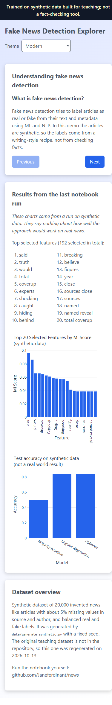
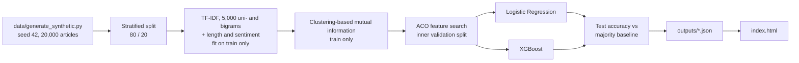

> **Trained on synthetic data built for teaching; not a fact-checking tool.**

# Fake News Detection Teaching Demo: feature selection with ant colony optimisation, on synthetic data

[](https://creativecommons.org/licenses/by-nc-sa/4.0/)
[](https://janeferdinant.github.io/news/)

## Overview

A teaching notebook and a small web page that walk through a text-classification pipeline: exploratory analysis, TF-IDF features, feature selection with ant colony optimisation (ACO) guided by clustering-based mutual information, and a comparison of Logistic Regression and XGBoost. It was written for an AI course (JNTUK, II Year, Term 1) and runs on CPU in under three minutes. **All data is synthetic, so the results illustrate the method and say nothing about detecting real fake news.**

## Demo

The page [`index.html`](index.html) is served by GitHub Pages at https://janeferdinant.github.io/news/. It shows a four-step explainer, the top features chosen by ACO and two charts read from the committed outputs in [`outputs/`](outputs/). It also has eight colour themes. It needs no server: React and Plotly load from a CDN, and the page code is precompiled.

To run it locally, from the repository root:

```bash
python -m http.server
```

Then open http://localhost:8000.



## Problem statement

Teaching text classification needs a dataset that students can regenerate, inspect and redistribute, with a feature-selection step that is easy to see. Because the data here is synthetic, the project does not claim to solve fake-news detection; it demonstrates the workflow and the evaluation discipline (split first, select features on training data only, report against a baseline).

## Approach



1. **Generate** synthetic articles (see Data).
2. **Split** the articles into train and test sets *before* anything is fitted.
3. **Features:** TF-IDF on the cleaned text (up to 5,000 unigrams and bigrams, fitted on the training articles only) plus three engineered features: text length, title length and TextBlob sentiment.
4. **Mutual information:** each feature's values are clustered into three groups with k-means, and the mutual information between cluster and label scores the feature (training data only).
5. **ACO:** 15 ants over 30 iterations each pick 50 to 200 features, favouring high MI and high pheromone. A subset is scored with Logistic Regression on an inner validation split of the training data. The test set is never used here.
6. **Compare** Logistic Regression and XGBoost on the selected features, using the held-out test split, with a majority-class baseline.

DistilBERT is **not** part of the comparison. An earlier version of the notebook and README listed it, but the code had never been run, had no `compute_metrics` function (its reported accuracy was always 0), and fine-tuning on CPU does not fit this project. The code was removed rather than fixed.

## Data

- **The original dataset is missing.** `fake_news_dataset.csv` (described in [`dataset_description.md`](dataset_description.md)) is not in this repository, and the owner does not remember where it came from. **On 2026-10-13 the generator [`data/generate_synthetic.py`](data/generate_synthetic.py) was added to regenerate a dataset** with the same seven columns the notebook expects (`title`, `text`, `date`, `source`, `author`, `category`, `label`). It does not reproduce the original rows.
- **Fully synthetic:** every article is assembled from template sentences about invented events. Outlets and author names are fictional. "Fake" articles differ from "real" ones only by writing style (sensational wording, capitals, exclamation marks, vague sources). The styles overlap by design: about 15% of articles of each label are written in the other label's style.
- **Size and balance:** 20,000 rows by default (10,000 real, 10,000 fake), 8 categories, 200 to 320 words per article, dates in the three years before 2026-10-01, and about 5% missing `source` and `author`.
- **Reproducible:** the output depends only on the seed (default 42). With the defaults the file's SHA-256 is `bd1d81f9236c8ee554d32c2053f5e1f0529cfb5cc7d657deef70eb1a53b4a923`.
- **Not committed:** the CSV is 33 MB and is git-ignored. Generate it with the command below.
- **Split:** stratified 80/20, `random_state=42`: 16,000 train and 4,000 test articles.
- **License and privacy:** the generator and its output are original work under CC BY-NC-SA 4.0. There is no personal data.

## Results

Measured on the 4,000 held-out synthetic test articles, with 192 features selected by ACO. Run log: [`docs/runs/2026-10-13-rerun.md`](docs/runs/2026-10-13-rerun.md).

| Metric | Value | Status | How measured | Date |
|---|---|---|---|---|
| Majority-class baseline accuracy | 0.5000 | Verified (re-run 2026-10-13 on regenerated synthetic data, seed=42) | share of the larger class in the test set | 2026-10-13 |
| Logistic Regression accuracy | 0.8400 | Verified (re-run 2026-10-13 on regenerated synthetic data, seed=42) | `accuracy_score` on the test split | 2026-10-13 |
| XGBoost accuracy | 0.8385 | Verified (re-run 2026-10-13 on regenerated synthetic data, seed=42) | `accuracy_score` on the test split | 2026-10-13 |
| ACO validation accuracy | 0.8234 | Verified (re-run 2026-10-13 on regenerated synthetic data, seed=42) | Logistic Regression on an inner validation split of the training data | 2026-10-13 |
| Notebook run time | 141 s | Verified (re-run 2026-10-13 on regenerated synthetic data, seed=42) | wall time of `jupyter nbconvert --execute` on 16 CPU threads | 2026-10-13 |

**Read these numbers with care.** They come from synthetic articles whose labels are a writing-style recipe, so they say nothing about real-world fake-news detection. The top features (`truth`, `coverup`, `shocking`, `caught`, `hiding`) are the generator's own trigger words. The two models differ by 6 of 4,000 articles, and only one split and one seed were run, so there is no basis for ranking them. The earlier "~90% accuracy" claim in this repository had no run behind it and has been removed.

## Tech stack

Python 3.11, pandas, NumPy, scikit-learn, XGBoost, NLTK, TextBlob, WordCloud, Matplotlib, Plotly (Python and plotly.js), Jupyter. The page uses React 18 (precompiled JSX, no in-browser Babel) and plotly.js 2.27, both loaded from a CDN with integrity hashes. An optional Flask script, `app.py`, serves the same JSON.

## Getting started

Prerequisites: Python 3.11 (verified on 3.11.9; the pinned NumPy 1.24.3 does not install on Python 3.12 or later) and about 2 GB of free memory (the TF-IDF matrix is dense, about 0.7 GB). The first run downloads two small NLTK data sets, so it needs internet access.

```bash
git clone https://github.com/Janeferdinant/news.git
cd news
python -m venv .venv
source .venv/bin/activate        # Windows: .venv\Scripts\activate
pip install -r requirements.txt
python data/generate_synthetic.py
jupyter nbconvert --to notebook --execute --ExecutePreprocessor.timeout=1200 --inplace fake_news_detection_enhanced_kaggle.ipynb
python -m http.server
```

Expected output: the generator prints `wrote .../data/fake_news_dataset.csv (20000 rows, 33,114,895 bytes)` and the SHA-256 above. The notebook run takes 2 to 3 minutes and rewrites the three files in `outputs/` with identical contents (it prints `Accuracy: 0.84` for Logistic Regression and `Accuracy: 0.8385` for XGBoost into the saved notebook). Then open http://localhost:8000. `--inplace` refreshes the outputs stored in the notebook. Interactive use works with `jupyter lab`. The notebook has not been tested on Kaggle or Colab.

To rebuild the page's JavaScript after editing `assets/app.jsx`:

```bash
npm install --no-save @babel/standalone@7.22.9
node scripts/build_jsx.mjs
```

To use the optional Flask server (not needed by the page): `pip install flask` and then `python app.py`, which serves `outputs/` at http://127.0.0.1:5000/get_kaggle_outputs.

## Project structure

```
README.md                                   this file
fake_news_detection_enhanced_kaggle.ipynb   the notebook (EDA, features, ACO, models, outputs)
data/generate_synthetic.py                  seeded generator for the synthetic dataset
dataset_description.md                      description of the dataset's columns
outputs/                                    mi_scores.json, model_comparison.json, selected_features.txt
index.html, assets/                         the live page (assets/app.jsx is the source of assets/app.js)
scripts/build_jsx.mjs                       compiles the JSX
app.py                                      optional local Flask server for outputs/
docs/runs/                                  dated run logs
requirements.txt                            pinned versions from the verified run
LICENSE, THIRD_PARTY_NOTICES.md             CC BY-NC-SA 4.0 and third-party notices
week1_day5_ai_interventions/                unrelated teaching mini-report (see below)
```

Earlier versions of this README described `backend/`, `frontend/`, `kaggle_notebook/` and `docs/` folders and a Flask and React application deployed to Heroku. Those folders never existed in this repository, and that deployment is not provided. The folder `week1_day5_ai_interventions/` has nothing to do with fake-news detection; it is a separate teaching mini-report, kept in place until the owner decides what to do with it.

## Real-world applications

- A classroom walk-through of a leak-free text-classification pipeline: split first, fit transformers on training data only, select features without touching the test set, compare against a baseline.
- A readable example of a metaheuristic (ACO) used for feature selection.
- A template for building small, reproducible teaching datasets with a seeded generator.

It is not suitable for judging real news. Real misinformation detection needs real labelled data, human fact-checkers and careful evaluation.

## Limitations

- All data is synthetic and the labels are defined by writing style, so accuracy on it says nothing about real fake news.
- The original dataset is unavailable, so no earlier result can be reproduced or compared.
- One split and one seed: no cross-validation and no confidence intervals. Differences of less than a point between models are not meaningful.
- ACO, as implemented, evaporates pheromone once per candidate subset rather than once per iteration, which quickly concentrates the search; the code was kept as written and not tuned.
- The mutual-information step uses `discrete_features=True` on the cluster labels (the earlier code treated them as continuous), and ACO uses a tiny floor on probabilities so every feature stays selectable.
- The TF-IDF matrix is dense, which limits the dataset size on small machines.
- Not tested on Kaggle or Colab. The pinned versions need Python 3.11.

## Future scope

- Train on a real, licensed, labelled news corpus and report results with cross-validation.
- Compare a fine-tuned transformer (for example DistilBERT) on a GPU, with a proper `compute_metrics`.
- Standard once-per-iteration pheromone evaporation and a comparison against simple filters such as chi-squared.
- Replace the bundled outputs with a live in-browser model.

## Credits & citation

- Course context: JNTUK AI course (II Year, Term 1), as stated in the original README.
- The original scaffold (README, `app.py`, `index.html`) had no recorded source; it may have been generated with an AI assistant or adapted from a template, and that is not known.
- Libraries: scikit-learn, XGBoost, pandas, NumPy, NLTK, TextBlob, WordCloud, Plotly, React.

## License

Original work © Jane Rose Ferdinant, licensed CC BY-NC-SA 4.0. Third-party components retain their own licenses; see THIRD_PARTY_NOTICES.md.

## Author

Jane Rose Ferdinant, [portfolio](https://janeferdinant.vercel.app) · [LinkedIn](https://www.linkedin.com/in/janerosenf/)
